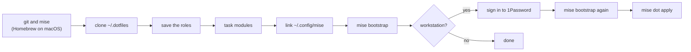
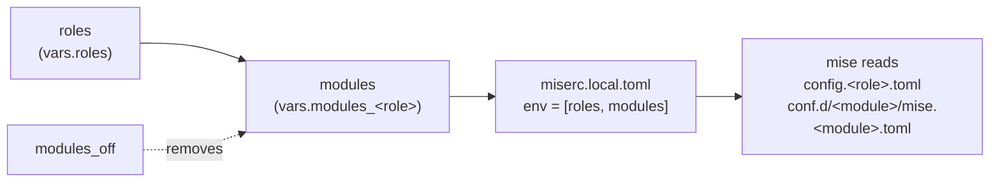
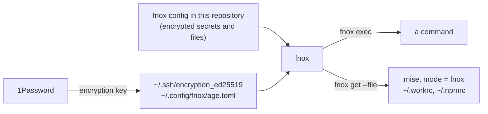

# Thomas' dotfiles

Bootstrap your local env in a single command!

This dotfiles repository is currently aimed for MacOS.

It's also suitable for use in [**GitHub Codespaces**](https://docs.github.com/codespaces/customizing-your-codespace/personalizing-codespaces-for-your-account#dotfiles), [**Gitpod**](https://www.gitpod.io/docs/config-dotfiles), [**VS Code Remote - Containers**](https://code.visualstudio.com/docs/remote/containers#_personalizing-with-dotfile-repositories), or even Linux distributions, through the [**role `minimal`**](#roles-and-modules).

Managed with [`mise`](https://mise.jdx.dev): mise links the dotfiles, installs the packages and the tools, and runs the setup tasks (`mise bootstrap`). [fnox](https://fnox.jdx.dev) keeps the secrets.

## Getting started

```bash
sh -c "$(curl -fsSL https://get.owpac.com/dotfiles)"
```

<details><summary>Using the full URL, or wget</summary>

```bash
sh -c "$(curl -fsSL https://raw.githubusercontent.com/owpac/dotfiles/main/install.sh)"
sh -c "$(wget -qO- https://raw.githubusercontent.com/owpac/dotfiles/main/install.sh)"
```

</details>

The script selects the roles of the machine:

| Machine | Roles |
| --- | --- |
| Dev Container, Codespace, Gitpod | `minimal` |
| SSH session (`SSH_CLIENT` is set) | `server` |
| Other | a question: `minimal`, `workstation` or `workstation work` |
| `DOTFILES_ROLES` is set | its value, for example `DOTFILES_ROLES="workstation work"` |

<details><summary>What the script does</summary>



The script always clones into `~/.dotfiles`: the config of mise expects this path. On a Mac, the first `mise bootstrap` installs 1Password. The second run writes the SSH keys and the files that read 1Password or fnox.

| Variable | Default |
| --- | --- |
| `DOTFILES_USER` | `owpac` |
| `DOTFILES_HTTPS_URL` | `https://github.com/${DOTFILES_USER}/dotfiles.git` |
| `DOTFILES_SSH_URL` | `git@github.com:${DOTFILES_USER}/dotfiles.git` |
| `DOTFILES_ROLES` | none: the script selects the roles |

</details>

## Roles and modules

A machine selects its setup on 3 axes:



- **Roles**: the type of machine. `mise/config.<role>.toml` holds the setup of a role and lists its modules.
- **Modules**: blocks of setup that a machine turns on as a whole. `modules/<module>/mise.<module>.toml` holds all the setup of a module.
- **Systems**: `macos` or `linux`. A module keeps its system variants: `os` on an entry, `os()` in a template.

mise selects its config environments before it reads the config. So the task `modules` writes the roles and the modules into `~/.config/mise/miserc.local.toml`, outside this repository.

| Role | Machine | Modules |
| --- | --- | --- |
| `minimal` | container, Codespace | `zsh`, `git` |
| `server` | the NAS and the Raspberry Pi | `zsh`, `git`, `ssh`, `sshd`, `pac`, `kompose`, `craft` |
| `workstation` | a Mac | `zsh`, `git`, `macos`, `ssh`, `secrets`, `pac`, `aerospace`, `agents`, `herdr`, `raycast`, `iterm2` |
| `workstation work` | a Mac for Doctolib | the modules of `workstation`, and `doctolib` |

| Module | Content |
| --- | --- |
| `zsh` | Oh My Zsh, Powerlevel10k, `.zshrc`, `.zshenv`, `.zprofile` |
| `git` | `.gitconfig`, signed commits with the SSH key of 1Password |
| `ssh` | `~/.ssh/config` and the public key of the Mac |
| `sshd` | the authorized keys of a server |
| `macos` | macOS preferences, Touch ID for sudo, login items, app preferences and backups |
| `secrets` | fnox, age and the encryption key from 1Password |
| `pac`, `kompose`, `craft` | the CLI tools of owpac, from their private repositories |
| `aerospace`, `herdr`, `raycast`, `iterm2` | the config of these apps |
| `agents` | Claude Code, Codex and Beads: settings, plugins, instructions |
| `doctolib` | PostgreSQL 15, `~/.workrc`, `~/.npmrc`, the git identity and `/etc/hosts` of Doctolib |

## Layout

```text
~/.dotfiles
├── install.sh
├── mise/                     → ~/.config/mise (one link for each file)
│   ├── config.toml           the base: settings, vars, task update
│   ├── config.<role>.toml    the setup and the modules of a role
│   ├── miserc.toml           auto_env = false: a module can have the name macos
│   └── tasks/modules         writes miserc.local.toml
├── modules/<module>/         → ~/.config/mise/conf.d/<module> (without home/ and data/)
│   ├── mise.<module>.toml    dotfile group, templates, packages, tools, hooks, tasks
│   ├── home/                 the files, at their path in ~
│   ├── tasks/                the setup scripts
│   └── data/                 the files that the tasks read (age)
├── lib/                      the shell functions of the tasks
└── docs/
```

A file of `modules/<module>/home/` goes to the same path in `~`: `modules/herdr/home/.config/herdr/config.toml` → `~/.config/herdr/config.toml`. mise links a plain file, and renders a template ([Tera](https://mise.jdx.dev/templates.html)).

## Daily use

| Goal | Command |
| --- | --- |
| Apply the setup | `mise bootstrap` (add `--dry-run` to see the changes first) |
| Pull this repository, then apply it | `mise run --skip-tools update` |
| See what differs | `mise bootstrap status`, `mise dot status`, `mise dot diff` |
| Change the roles of this machine | `mise vars roles="workstation work"`, then `mise run --skip-tools update` |
| Turn off a module on this machine | `mise vars modules_off="<module> <module>"`, then `mise run --skip-tools update` |
| Edit a linked file | edit it in place: the change goes into this repository |
| Edit a template | edit it in `modules/<module>/home/`, then `mise dot apply` |
| Add a file to a module | `mise dot add --group <module> <file>` |
| Add a template | add `"~/<file>" = { mode = "template" }` under `[dotfile_groups.<module>.entries]` |
| Remove a file | remove its source, then `mise dot apply --prune` |
| Add a package | add it to the file of its module (`os = "macos"` for one system only) |
| Add a tool | `mise use --global <tool>`, then commit the change |
| Add a module | create `modules/<module>/mise.<module>.toml` and `home/`, add the module to the list of a role, then `mise run --skip-tools update` |
| Add a file to `mise/` or to a module config | `mise dot apply` creates its link, then mise reads the file |
| Remove a module | `mise dot unapply --group <module>`, then remove its folder, its name in the lists of the roles, and its tasks in the task `bootstrap` |

> [!NOTE]
> - `--skip-tools`: before a task, mise installs all the tools of the config, and a failed install stops the task. `update` needs no tool.
> - `update` runs `git pull`, the task `modules`, then `mise bootstrap --update --prune-dotfiles`. It replaces `chezmoi update`.
> - A cask (`brew-cask:`) that mise installs gets the metadata of Homebrew (`homebrew_metadata`), so `brew upgrade` sees it. A cask of a third-party tap stays with mise.
> - A machine without access to the private repositories of owpac turns off `pac`, `kompose` and `craft`.
> - Do not edit `~/.config/mise/miserc.local.toml`: the task `modules` writes it again.

## Secrets



| Goal | Command |
| --- | --- |
| Add or change a secret | `fnox set <NAME> --global --provider age` (add `--profile doctolib` for Doctolib) |
| Add a private file | `fnox set --file <file> --provider age`, then `"<file>" = { mode = "fnox" }` in a module |
| Run a command with the secrets | `fnox exec -- <command>` |
| Edit `~/.workrc` or `~/.npmrc` | `mise dot edit --apply ~/.workrc` (mise runs `fnox edit --file`) |
| Edit the domains of Doctolib | `fnox edit DOCTOLIB_HOSTS --profile doctolib`, then `mise run generate-hosts` |
| Put back a file that you edited directly | `fnox set --file ~/.workrc --provider age` |
| Write `/etc/hosts` for Doctolib | `mise run generate-hosts` |
| Backups and snapshots of app preferences | age files in `modules/macos/data/` (see the [guide](./docs/macos-preferences.md)) |

> [!WARNING]
> - Do not run `mise dot add` on a secret file: mise copies the content in clear text into this repository.
> - Do not edit `~/.workrc` or `~/.npmrc` directly: the next `mise dot apply` writes them again from fnox. Use `mise dot edit --apply`.
> - No secret enters the interactive shell (`env = "exec"`): a command gets the secrets only with `fnox exec`.

## Requirements

| Tool | Version | Why |
| --- | --- | --- |
| mise | 2026.10.23 or later | `pypi:git+ssh://` sources on github.com without a token, `homebrew_metadata`, `mode = "fnox"` |
| fnox | 1.45.0 or later | files stored by path (`[files]`) in a linked global config, `fnox edit <NAME>` |
| pac, kompose, craft | a tag `YYYY.MM.N` on each push | mise follows the last tag with `latest` |

## Migrate a machine with chezmoi

`install.sh` does not migrate a machine where chezmoi wrote the dotfiles: mise needs `--force-dotfiles` to replace these files.

1. `git -C ~/.dotfiles switch main`, then `git -C ~/.dotfiles pull`.
2. `mv ~/.config/mise ~/.config/mise.before-mise`, then `mkdir -p ~/.config/mise`.
3. `MISE_CONFIG_DIR=~/.dotfiles/mise mise vars roles="<roles>"`, then `MISE_CONFIG_DIR=~/.dotfiles/mise mise run --skip-tools modules`.
4. `MISE_CONFIG_DIR=~/.dotfiles/mise mise dot apply --yes ~/.config/mise ~/.config/mise/conf.d`.
5. `mise dot apply --yes --force ~/.ssh/encryption_ed25519 ~/.ssh/encryption_ed25519.pub ~/.config/fnox/age.toml ~/.config/fnox/config.toml`: mise reads the files of fnox before it writes any file, so the key and the config of fnox must exist first.
6. `mise bootstrap --force-dotfiles`.

> [!CAUTION]
> Do not run `chezmoi purge`: the source directory of chezmoi is `~/.dotfiles`, so this command deletes this repository. Remove `~/.config/chezmoi` and `~/.cache/chezmoi`, then uninstall chezmoi.

The branch [`chezmoi`](https://github.com/owpac/dotfiles/tree/chezmoi) keeps the last version with chezmoi.

## Guides

- [Tracking macOS app preferences](./docs/macos-preferences.md): snapshot and re-import app settings with `pac preferences`, without the noise of a tracked live plist.
