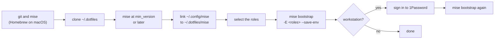
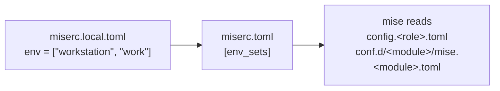
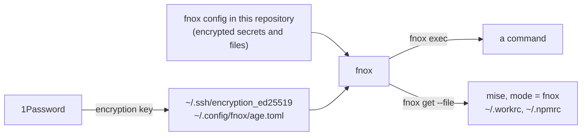

# Thomas' dotfiles

Bootstrap your local env in a single command!

This dotfiles repository is currently aimed for MacOS.

It's also suitable for use in [**GitHub Codespaces**](https://docs.github.com/codespaces/customizing-your-codespace/personalizing-codespaces-for-your-account#dotfiles), [**Gitpod**](https://www.gitpod.io/docs/config-dotfiles), [**VS Code Remote - Containers**](https://code.visualstudio.com/docs/remote/containers#_personalizing-with-dotfile-repositories), or even Linux distributions, through the [**role `minimal`**](#roles-and-modules).

Managed with [`mise`](https://mise.jdx.dev): mise links the dotfiles, installs the packages and the tools, and runs the setup tasks (`mise bootstrap`). [fnox](https://fnox.jdx.dev) keeps the secrets.

## Getting started

```bash
sh -c "$(curl -fsSL https://get.owpac.com/dotfiles)"
```

<details><summary>Using the full URL, or wget</summary>

```bash
sh -c "$(curl -fsSL https://raw.githubusercontent.com/owpac/dotfiles/main/install.sh)"
sh -c "$(wget -qO- https://raw.githubusercontent.com/owpac/dotfiles/main/install.sh)"
```

</details>

The script selects the roles of the machine:

| Machine | Roles |
| --- | --- |
| Dev Container, Codespace, Gitpod | `minimal` |
| SSH session (`SSH_CLIENT` is set) | `server` |
| Other | a question: `minimal`, `workstation` or `workstation work` |
| `DOTFILES_ROLES` is set | its value, for example `DOTFILES_ROLES="workstation work"` |

<details><summary>What the script does</summary>



The script always clones into `~/.dotfiles`: the config of mise expects this path. If mise is older than `min_version` in `mise/config.toml`, the script installs this version: the script of mise installs a version older than 24 hours only. On a Mac, the first `mise bootstrap` installs 1Password. The second run writes the SSH keys and the files that read 1Password or fnox.

| Variable | Default |
| --- | --- |
| `DOTFILES_USER` | `owpac` |
| `DOTFILES_HTTPS_URL` | `https://github.com/${DOTFILES_USER}/dotfiles.git` |
| `DOTFILES_SSH_URL` | `git@github.com:${DOTFILES_USER}/dotfiles.git` |
| `DOTFILES_ROLES` | none: the script selects the roles |

</details>

## Roles and modules

A machine selects its setup on 3 axes:



- **Roles**: the type of machine. A role is a set of environments (`[env_sets]` in `mise/miserc.toml`): the environment of the role and its modules. `mise/config.<role>.toml` holds the setup of a role.
- **Modules**: blocks of setup that a machine turns on as a whole. `mise/conf.d/<module>/mise.<module>.toml` holds all the setup of a module.
- **Systems**: `macos` or `linux`. A module keeps its system variants: `os` on an entry, `os()` in a template. `mise/miserc.toml` sets `auto_env = false`, so mise adds no platform environment, and a module can have the name `macos`.

A machine saves its roles in `mise/miserc.local.toml`, for example `env = ["workstation", "work"]`. git ignores this file. mise expands the sets before it reads the config, and `{{ mise_env }}` holds the expanded list. A set expands one level only, so each set lists all its modules. `mise bootstrap` prints the roles and the modules of the machine on the first line of its task `bootstrap`.

A module keeps its role variants: `"work" in mise_env` in a template, `env = "work"` on a package, `variants = [{ profile = "work" }]` on a whole file. A role and a module never have the same name.

| Role | Machine | Modules |
| --- | --- | --- |
| `minimal` | container, Codespace | `zsh`, `git` |
| `server` | the NAS and the Raspberry Pi | `zsh`, `git`, `ssh`, `sshd`, `pac`, `kompose`, `craft` |
| `workstation` | a Mac | `zsh`, `git`, `macos`, `ssh`, `secrets`, `pac`, `aerospace`, `agents`, `herdr`, `raycast`, `iterm2` |
| `workstation work` | a Mac for Doctolib | the modules of `workstation`, and `doctolib` |

A machine that needs another list of modules gets its own set in `mise/miserc.toml`, for example a server without access to the private repositories of owpac.

| Module | Content |
| --- | --- |
| `zsh` | Oh My Zsh, Powerlevel10k, `.zshenv` (the variables of each shell, `EDITOR` and `VISUAL` included), `.zprofile` (Homebrew), `.zshrc` (the interactive shell) |
| `git` | `.gitconfig`, signed commits with the SSH key of 1Password |
| `ssh` | `~/.ssh/config` and the public key of the Mac |
| `sshd` | the authorized keys of a server |
| `macos` | macOS preferences, Touch ID for sudo, login items, app preferences and backups |
| `secrets` | fnox, age and the encryption key from 1Password |
| `pac`, `kompose`, `craft` | the CLI tools of owpac, from their private repositories |
| `aerospace`, `herdr`, `raycast`, `iterm2` | the config of these apps |
| `agents` | Claude Code, Codex, Beads and worktrunk: settings, plugins, instructions. The marketplace owpac is a clone in `~/.agents/marketplaces` |
| `doctolib` | PostgreSQL 15, `~/.workrc`, `~/.npmrc`, the git identity and `/etc/hosts` of Doctolib |

## Layout

```text
~/.dotfiles
├── install.sh
├── mise/                         ← ~/.config/mise is one link to this folder
│   ├── config.toml               the base: min_version, settings, vars, task bootstrap
│   ├── config.<role>.toml        the setup of a role
│   ├── miserc.toml               the roles ([env_sets]), and auto_env = false
│   ├── miserc.local.toml         the roles of this machine (git ignores it)
│   └── conf.d/<module>/
│       ├── mise.<module>.toml    dotfile group, templates, packages, tools, hooks, tasks
│       ├── home/                 the files, at their path in ~
│       ├── tasks/                the setup scripts
│       └── data/                 the files that the tasks read (age)
├── lib/                          the shell functions of the tasks
└── docs/
```

`~/.config/mise` is one link to `mise/`, as `mise bootstrap --config-dir mise` makes it. So each mise command reads this config, from any directory, and `mise use --global` writes into `mise/config.toml`. mise reads `conf.d/<module>/mise.<module>.toml` only when the machine selects the module, and reads no other file of the folder.

A file of `mise/conf.d/<module>/home/` goes to the same path in `~`: `mise/conf.d/herdr/home/.config/herdr/config.toml` → `~/.config/herdr/config.toml`. mise links a plain file, and renders a template ([Tera](https://mise.jdx.dev/templates.html)).

## Daily use

| Goal | Command |
| --- | --- |
| Apply the setup | `mise bootstrap` (add `--dry-run` to see the changes first) |
| Pull this repository, then apply it | `mise bootstrap --update --prune-dotfiles` |
| See what differs | `mise bootstrap status`, `mise dot status`, `mise dot diff` |
| See the roles and the modules of this machine | `mise exec -- printenv MISE_ENV` |
| Change the roles of this machine | `mise bootstrap -E workstation,work --save-env --prune-dotfiles` |
| Turn off a module on this machine | add a set without the module to `[env_sets]` in `mise/miserc.toml`, then `mise bootstrap -E <set> --save-env --prune-dotfiles` |
| Edit a linked file | edit it in place: the change goes into this repository |
| Edit a template | edit it in `mise/conf.d/<module>/home/`, then `mise dot apply` |
| Add a file to a module | `mise dot add --group <module> <file>` |
| Add a template | add `"~/<file>" = { mode = "template" }` under `[dotfile_groups.<module>.entries]` |
| Remove a file | remove its source, then `mise dot apply --prune` |
| Add a package | add it to the file of its module (`os = "macos"` for one system only) |
| Add a tool | `mise use --global <tool>`, then commit the change |
| Add a module | create `mise/conf.d/<module>/mise.<module>.toml` and `home/`, add the module to the set of a role in `mise/miserc.toml`, then `mise bootstrap` |
| Remove a module | `mise dot unapply --group <module>`, then remove its folder, its name in the sets of `mise/miserc.toml`, and its tasks in the task `bootstrap` |

> [!NOTE]
> - `mise bootstrap --update` fast-forwards this repository, then runs again with the new config, the new sets included. It replaces `chezmoi update`.
> - `--prune-dotfiles` removes the files that a group does not deploy any more, for example after a pull removed a module. mise asks before it removes a file.
> - A cask (`brew-cask:`) that mise installs gets the metadata of Homebrew (`homebrew_metadata`), so `brew upgrade` sees it. A cask of a third-party tap stays with mise.
> - A machine without access to the private repositories of owpac uses a set without `pac`, `kompose` and `craft`.
> - `--save-env` writes `env` in `mise/miserc.local.toml`, and keeps the other keys of the file.

## Secrets



| Goal | Command |
| --- | --- |
| Add or change a secret | `fnox set <NAME> --global --provider age` (add `--profile doctolib` for Doctolib) |
| Add a private file | `fnox set --file <file> --provider age`, then `"<file>" = { mode = "fnox" }` in a module |
| Run a command with the secrets | `fnox exec -- <command>` |
| Edit `~/.workrc` or `~/.npmrc` | `mise dot edit --apply ~/.workrc` (mise runs `fnox edit --file`) |
| Edit the domains of Doctolib | `fnox edit DOCTOLIB_HOSTS --profile doctolib`, then `mise run generate-hosts` |
| Put back a file that you edited directly | `fnox set --file ~/.workrc --provider age` |
| Write `/etc/hosts` for Doctolib | `mise run generate-hosts` |
| Backups and snapshots of app preferences | age files in `mise/conf.d/macos/data/` (see the [guide](./docs/macos-preferences.md)) |

> [!WARNING]
> - Do not run `mise dot add` on a secret file: mise copies the content in clear text into this repository.
> - Do not edit `~/.workrc` or `~/.npmrc` directly: the next `mise dot apply` writes them again from fnox. Use `mise dot edit --apply`.
> - No secret enters the interactive shell (`env = "exec"`): a command gets the secrets only with `fnox exec`.

## Requirements

| Tool | Version | Why |
| --- | --- | --- |
| mise | 2026.11.1 or later (`min_version` in `mise/config.toml`) | `pypi:git+ssh://` sources on github.com, `homebrew_metadata`, `mode = "fnox"`, `depends` of a dotfile group, `bootstrap --update` of a linked config, `[env_sets]` and `--save-env` |
| fnox | 1.45.0 or later | files stored by path (`[files]`) in a linked global config, `fnox edit <NAME>` |
| Homebrew | 6.0.22 or later, on a Mac | mise writes the install receipt of a cask that it installs (`homebrew_metadata`) |
| pac, kompose, craft | a tag `YYYY.MM.N` on each push | mise follows the last tag with `latest` |

## Migrate a machine with chezmoi

`install.sh` does not migrate a machine where chezmoi wrote the dotfiles: mise needs `--force-dotfiles` to replace these files.

1. `git -C ~/.dotfiles switch main`, then `git -C ~/.dotfiles pull`.
2. `mv ~/.config/mise ~/.config/mise.before-mise`, then `ln -s ~/.dotfiles/mise ~/.config/mise`.
3. `mise bootstrap -E <roles> --save-env --force-dotfiles`, for example `-E workstation,work`.
4. Remove `~/.config/chezmoi` and `~/.cache/chezmoi`, then uninstall chezmoi.

> [!CAUTION]
> Do not run `chezmoi purge`: the source directory of chezmoi is `~/.dotfiles`, so this command deletes this repository.

The branch [`chezmoi`](https://github.com/owpac/dotfiles/tree/chezmoi) keeps the last version with chezmoi. Until its migration, a machine with chezmoi follows this branch: `git -C ~/.dotfiles switch -c chezmoi --track origin/chezmoi`.

## Guides

- [Tracking macOS app preferences](./docs/macos-preferences.md): snapshot and re-import app settings with `pac preferences`, without the noise of a tracked live plist.
